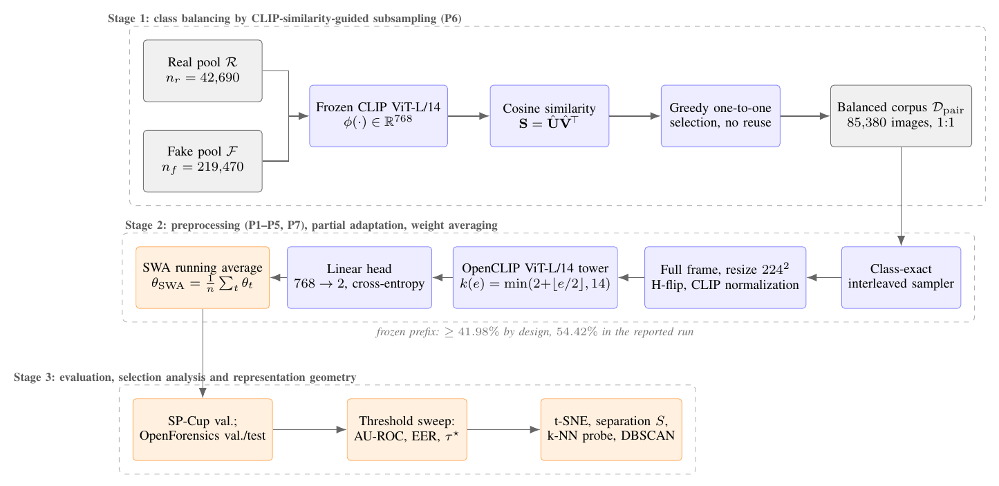
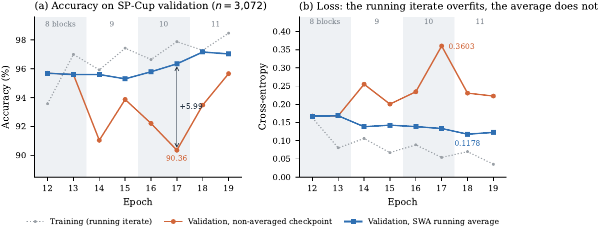
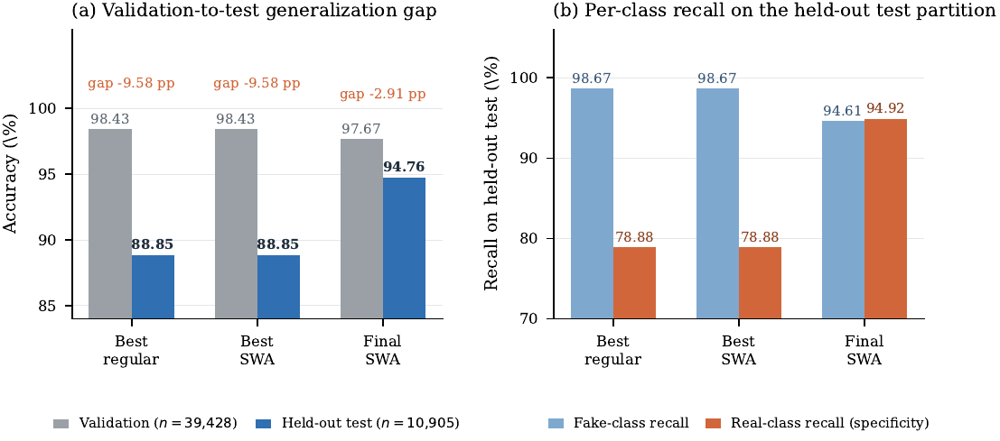
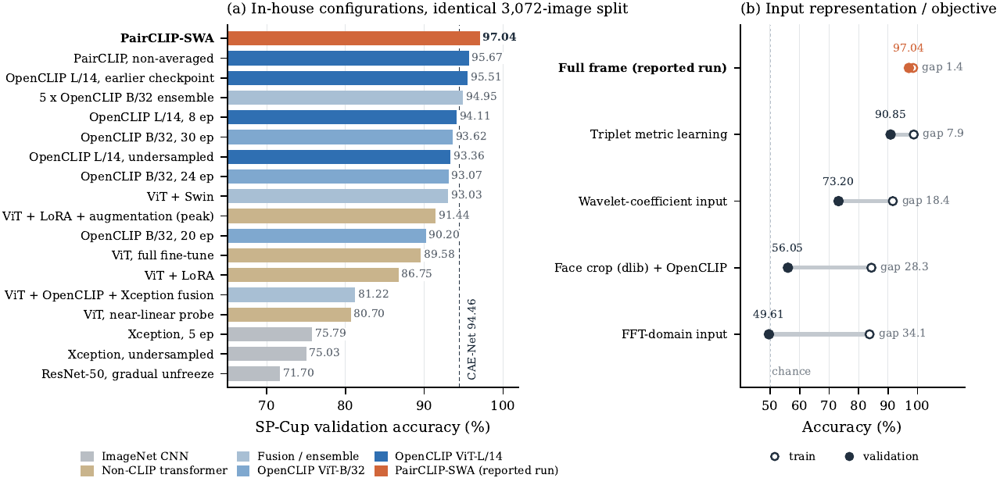

<div align="center">

# PairCLIP-SWA

### Similarity-Guided Balancing and Stochastic Weight Averaging for Generalized Deepfake Image Detection with OpenCLIP

**Md. Nakib · Sudipto Sarkar · A. J. A. Jubayer Talukder · Arif Mahmud**

Department of Electrical and Electronic Engineering, BUET, Dhaka 1205, Bangladesh

[](paper/main.pdf)
[](paper/main.pdf)
[](LICENSE)
[](https://github.com/mlfoundations/open_clip)
[](paper/main.tex)

</div>

---

## Overview

Deepfake detectors are almost always deployed as the single checkpoint that scored best on a validation split, yet the reliability of that choice is rarely measured. This repository contains the manuscript, figures and experiment outputs of **PairCLIP-SWA**, a single-backbone detector that

1. builds a class-balanced training corpus by **CLIP-similarity-guided one-to-one subsampling** of the majority (fake) class,
2. adapts an **OpenCLIP ViT-L/14** visual tower with **progressive block unfreezing** and a linear head, and
3. averages the fine-tuning trajectory with **stochastic weight averaging (SWA)**,

and uses it to measure how unstable, and how misleading, best-checkpoint selection is for forensic detectors.

<p align="center">
  
</p>

## Key results

### IEEE SP Cup 2025 (DF-Wild-Cup) — validation set, n = 3,072

Both systems are trained on the DF-Wild-Cup training partition and evaluated on the same official validation split.

| Metric | CAE-Net ensemble [[1]](#references) | **PairCLIP-SWA** |
|---|:---:|:---:|
| Accuracy (%) | 94.46 | **97.04** |
| AU-ROC (%) | 97.60 | **98.64** |
| Equal error rate (%) | 5.00 | **4.07** |
| F1, fake class (%) | 94.64 | **97.23**&dagger; |
| Backbones / forward passes | 3 / 3 | **1 / 1** |
| Training images used | 262,160 | **85,380** |
| Parameters | **117.4 M** | 304.0 M |

&dagger; At the accuracy-optimal threshold, selected on the same split (optimistic).

### Checkpoint selection can mislead

During training, the non-averaged checkpoint's validation accuracy swings across **5.34 points**, while the SWA average is never worse and up to **5.99 points** better.

<p align="center">
  
</p>

On an OpenForensics-derived benchmark, the checkpoint that validation accuracy selects makes **2.1&times; as many errors** on a disjoint held-out test partition as the checkpoint it ranks last:

| Checkpoint | Validation (n = 39,428) | Held-out test (n = 10,905) | Test real-class recall |
|---|:---:|:---:|:---:|
| Best regular / best SWA (validation-selected) | **98.43** | 88.85 | 78.88 |
| Final SWA | 97.67 | **94.76** | **94.92** |

<p align="center">
  
</p>

### Design-space study

Twenty-two in-house configurations on the identical DF-Wild-Cup split show that CLIP pre-training, not ensembling, drives accuracy; that secondary face cropping costs about 34 points; and that frequency-domain inputs transfer poorly.

<p align="center">
  
</p>

## Repository structure

```
PairCLIP-SWA/
├── paper/
│   ├── main.tex, main.pdf, main.bbl   # current manuscript (IEEEtran)
│   ├── references.bib
│   ├── figures/                       # figures included by main.tex
│   └── archive/v2-before-audit/       # previous manuscript version and its figures
├── notebooks/
│   ├── clip-vit-l-jan-09.ipynb        # training and evaluation (OpenCLIP ViT-L/14 + SWA)
│   └── feature-extraction.ipynb       # CLIP-similarity-guided subsampling
├── scripts/                           # regenerate every figure in paper/figures
│   ├── plot_dfwildcup_benchmarks.py
│   ├── plot_openforensics_selection.py
│   └── plot_training_dynamics.py
├── results/
│   ├── summary_accuracies.txt
│   ├── dfwildcup/tsne/                # t-SNE analyses, DF-Wild-Cup validation
│   └── openforensics/
│       ├── confusion_matrices/        # validation and test, three checkpoints
│       ├── sample_predictions/        # qualitative test predictions
│       ├── tsne/
│       └── notebook_outputs/
├── docs/
│   ├── evidence_audit.pdf             # audit of the manuscript against the Kaggle logs
│   ├── REVISION_NOTES.md              # changes, open verification items, planned runs
│   └── assets/                        # images used in this README
├── references/
│   └── CAE-Net_arXiv-2502.10682v3.pdf # third-party baseline paper
├── CITATION.cff
└── LICENSE
```

## Reproducing

**Build the paper** (TeX Live or MiKTeX with `IEEEtran`):

```bash
cd paper
pdflatex main && bibtex main && pdflatex main && pdflatex main
```

**Regenerate the figures** (Python 3.10+, `matplotlib`, `numpy`, `Pillow`), from the repository root:

```bash
python scripts/plot_dfwildcup_benchmarks.py
python scripts/plot_openforensics_selection.py
python scripts/plot_training_dynamics.py
```

**Train and evaluate.** The notebooks target Kaggle (PyTorch, `open_clip_torch`, 2&times; NVIDIA T4). The main configuration is OpenCLIP ViT-L/14 with OpenAI weights, batch 32 with exactly 16 real and 16 fake images, AdamW at 1e-4 without weight decay, mixed precision, progressive unfreezing `k(e) = min(2 + floor(e/2), 14)`, and SWA from epoch 12. See Table IV of the paper for the full configuration.

### Reproducibility notes

- The notebooks here are later-edited local copies. The Kaggle versions and their execution logs, summarized in [`docs/evidence_audit.pdf`](docs/evidence_audit.pdf), are the source of truth for the reported numbers.
- In the reported run, the subsampling notebook applies `ToTensor()` before `CLIPProcessor`, which rescales pixel values twice. Pass PIL images or set `do_rescale=False` to get the intended embeddings. See Section IV-B of the paper and [`docs/REVISION_NOTES.md`](docs/REVISION_NOTES.md).

## Datasets

| Dataset | Use | Source |
|---|---|---|
| IEEE SP Cup 2025 (DF-Wild-Cup) | training and validation | IEEE Signal Processing Society; built on [DeepfakeBench](https://github.com/SCLBD/DeepfakeBench) |
| OpenForensics-derived "Deepfake and Real Images" | training, validation, held-out test | [Kaggle](https://www.kaggle.com/datasets/manjilkarki/deepfake-and-real-images) |

The datasets are not redistributed in this repository.

## Citation

If you use this work, please cite:

```bibtex
@unpublished{nakib2026pairclipswa,
  author = {Nakib, Md. and Sarkar, Sudipto and Talukder, A. J. A. Jubayer and Mahmud, Arif},
  title  = {{PairCLIP-SWA}: Similarity-Guided Balancing and Stochastic Weight Averaging
            for Generalized Deepfake Image Detection with {OpenCLIP}},
  note   = {Manuscript submitted for publication},
  year   = {2026}
}
```

## References

1. A. Bhattacharjee, K. Islam, K. Anan, A. Intesher, A. A. Fuad, U. Saha, and H. Imtiaz, "CAE-Net: Generalized deepfake image detection using convolution and attention mechanisms with spatial and frequency domain features," *Journal of Visual Communication and Image Representation*, 2026. [arXiv:2502.10682](https://arxiv.org/abs/2502.10682)

## License

This repository is released under the [MIT License](LICENSE). Third-party material, in particular the paper in `references/`, remains the property of its authors and is not covered by this license.

## Acknowledgments

We thank the IEEE Signal Processing Society for organizing the Signal Processing Cup 2025 and releasing the DF-Wild-Cup dataset, and the maintainers of [OpenCLIP](https://github.com/mlfoundations/open_clip) for the pre-trained models.
